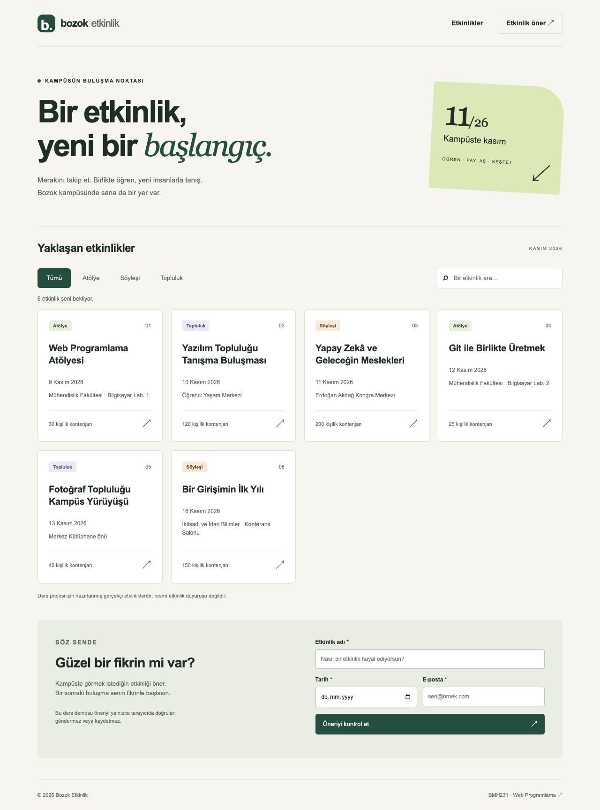

# Bozok Etkinlik

BMH231 Web Programlama Ödev 2 için semantik HTML, duyarlı CSS ve JavaScript ile hazırlanmış kampüs etkinlik panosu. Sunucu yalnızca Node.js'in `http`, `fs`, `path` modüllerini kullanır. Express, ön yüz framework'ü ve harici çalışma zamanı bağımlılığı yoktur.

## Çalıştırma

Node.js 22 veya üzeri gerekir.

```sh
git clone https://github.com/Emir-Kanbur/bmh231-odev2.git
cd bmh231-odev2
npm start
```

Tarayıcıda http://localhost:3000 adresini açın. `npm install` gerekmez. Sunucuyu Ctrl+C ile durdurabilirsiniz. 3000 portu başka bir uygulama tarafından kullanılıyorsa önce o uygulamayı kapatın.

```sh
npm run check
npm test
```

`check`, kaynakların JavaScript sözdizimini; `test`, gerçek HTTP istekleriyle altı sunucu senaryosunu kontrol eder. Derleme, TypeScript veya lint aracı kullanılmaz; dosyalar doğrudan çalıştırılır.

## API sözleşmesi

Tek veri kaynağı `etkinlikler.json` dosyasıdır. Alanlar: `id` (benzersiz tamsayı), `baslik` (metin), `tur` (`atolye`, `soylesi`, `topluluk`), `tarih` (`YYYY-AA-GG`), `yer` (metin), `kontenjan` (negatif olmayan tamsayı). İstemci gelen verinin biçimini kontrol eder. Bilinmeyen tür filtresi boş dizi döndürür.

| Yöntem ve yol | Durum | Yanıt |
|---|---|---|
| GET / | 200 | public/index.html |
| GET /stil.css, /betik.js | 200 | UTF-8 CSS / JavaScript |
| GET /api/etkinlikler | 200 | Etkinlik dizisi |
| GET /api/etkinlikler?tur=atolye | 200 | Filtrelenmiş dizi |
| GET /api/etkinlikler/2 | 200 | Tek etkinlik |
| GET /api/etkinlikler/999 | 404 | `{"hata":"Etkinlik bulunamadı"}` |
| GET /bilinmeyen | 404 | Düz metin |
| GET /%ZZ | 400 | Geçersiz yol |
| GET dışındaki yöntemler | 405 | Düz metin, Allow: GET |
| Veri dosyası okunamazsa API | 500 | JSON hata |

API JSON yanıtları `application/json; charset=utf-8` kullanır. Statik dosyalar yalnızca `public/` içinden sunulur; sembolik bağlantıyla dışarı çıkış da engellenir.

## Kullanım

- Tür düğmeleriyle filtreleyin, başlığa göre arayın. Türkçe büyük/küçük harf dönüşümü kullanılır.
- Öneri formunda en az beş karakterli bir başlık, bugün veya gelecek tarih ve geçerli e-posta girin.
- Form öneriyi **göndermez veya kaydetmez**; yalnızca istemci tarafında doğrular.
- Yükleme başarısız olduğunda “Yeniden dene” düğmesini kullanın.
- Tab tuşuyla gezinilebilir; ilk bağlantı doğrudan listeye atlar.

Etkinlikler gerçekçi ders örnekleridir; resmî duyuru veya gerçek katılım kaydı değildir. Emir Kanbur, Açık Kaynak Yazılım Geliştirme Topluluğu üyesi olduğunu belirtmiştir. Kimliği 2 olan tanışma buluşması bu toplulukla ilişkilendirilmiş gerçekçi bir ders örneğidir; resmî etkinlik ilanı değildir. [Üniversitenin topluluk sayfası](https://topluluklar.bozok.edu.tr/Home/Topluluk?GUID=3A759AC7-894D-4B8D-AEF2-6473988383C0).

## Görünüm



Mobil, filtre, boş sonuç, form ve hata durumları `docs/` klasöründedir. API test çıktıları, Lighthouse ham raporları, curl çıktıları ve ağ ölçümleri de aynı klasörde tutulur.

## Teslim durumu ve yapay zekâ kullanımı

Uygulama, testler, açıklamalar ve rapor OpenAI Codex yardımıyla üretilmiştir. Öğrenci tarafından bağımsız yazılmış gibi sunulmamalıdır. Ödev yönergesi doğrudan yapay zekâya ödev hazırlatılmasını kabul etmediği için bu çalışma teslim kurallarını karşılayan bağımsız öğrenci çalışması olarak değerlendirilemez.

Commit tarihleri gerçektir. En az iki farklı güne yayılmış commit koşulu ilk hazırlama gününde tamamlanamaz; sonraki bir günde gerçek bir çalışma ve commit gerekir. Ölçümlerdeki otomatik tarayıcı/CDP yöntemi ve DevTools arayüzüyle istenen adımlardan ayrılan noktalar PDF raporunda açıkça belirtilmiştir. BOYSİS yüklemesi yapılmamıştır.

İsteğe bağlı tarayıcı testleri: `npm install --no-save playwright`, `npx playwright install chromium`, ayrı uçbirimde `npm start`, ardından `node scripts/tarayici-testleri.cjs`. Kurulu bir Chromium kullanmak için `BROWSER_PATH` ortam değişkenini tanımlayın. Bu araç uygulamanın çalışma zamanı bağımlılığı değildir. Lighthouse raporları Lighthouse 13.5.0 ile yalnızca Accessibility kategorisinde alınmıştır. Gerçek DevTools Network/Console ve 390/1280 cihaz görünümü ekranları da docs klasöründedir.

## 27 Ekim ek incelemesi

Topluluk bilgisi öğrencinin üyelik beyanıyla güncellendi. DevTools Lighthouse panelinde yalnız Accessibility ile 100 → 94 → 100 deneyi tekrarlandı. [Güncel kontrol ve kalan maddeler](docs/inceleme-20261027/UYGUNLUK-KONTROLU.md) ile gerçek yeni kanıtlar ayrı klasördedir. İlk rapordaki topluluk bilgisinin doğrulanmadığı notu bu güncellemeyle aşılmıştır. İki gün şartı ve diğer kişisel/ölçüm eksikleri kontrol kaydında açıkça korunur.
