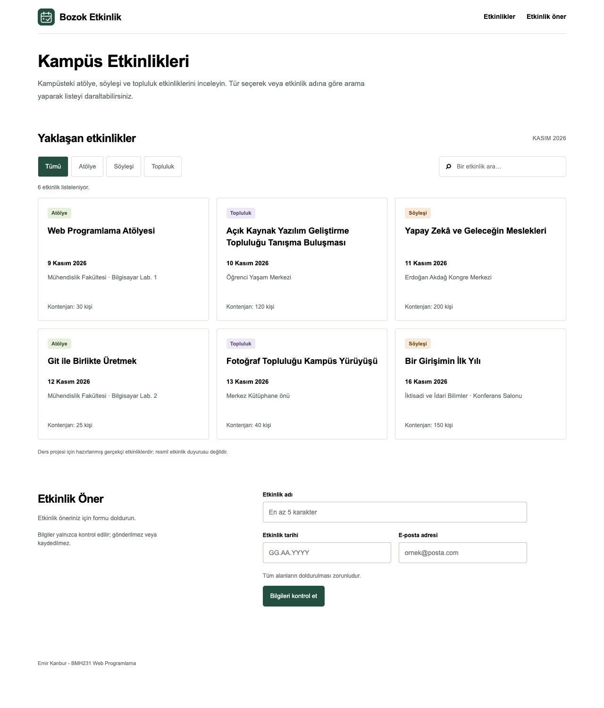

# Bozok Etkinlik

BMH231 Web Programlama Ödev 2 için semantik HTML, duyarlı CSS ve JavaScript ile hazırlanmış kampüs etkinlik panosu. Sunucu yalnızca Node.js'in `http`, `fs`, `path` modüllerini kullanır. Express, ön yüz framework'ü ve harici çalışma zamanı bağımlılığı yoktur.

## Çalıştırma

Node.js 22 veya üzeri gerekir.

```sh
git clone https://github.com/Emir-Kanbur/bmh231-odev2.git
cd bmh231-odev2
npm start
```

Tarayıcıda http://localhost:3000 adresini açın. `npm install` gerekmez. Sunucuyu Ctrl+C ile durdurabilirsiniz. 3000 portu başka bir uygulama tarafından kullanılıyorsa önce o uygulamayı kapatın.

```sh
npm run check
npm test
```

`check`, kaynakların JavaScript sözdizimini; test, Node.js'in test sistemiyle API, HTTP durum kodları, dosya erişimi ve hata senaryolarını kontrol eder. Veri dosyası bulunamadığında API'nin 500 JSON, bilinmeyen dosyaların 404 döndürmesi de test edilir. Derleme, TypeScript veya lint aracı kullanılmaz; dosyalar doğrudan çalıştırılır.

## API sözleşmesi

Tek veri kaynağı `etkinlikler.json` dosyasıdır. Alanlar: `id` (benzersiz tamsayı), `baslik` (metin), `tur` (`atolye`, `soylesi`, `topluluk`), `tarih` (`YYYY-AA-GG`), `yer` (metin), `kontenjan` (negatif olmayan tamsayı). İstemci gelen verinin biçimini kontrol eder. Bilinmeyen tür filtresi boş dizi döndürür.

| Yöntem ve yol | Durum | Yanıt |
|---|---|---|
| GET / | 200 | public/index.html |
| GET /stil.css, /betik.js | 200 | UTF-8 CSS / JavaScript |
| GET /api/etkinlikler | 200 | Etkinlik dizisi |
| GET /api/etkinlikler?tur=atolye | 200 | Filtrelenmiş dizi |
| GET /api/etkinlikler/2 | 200 | Tek etkinlik |
| GET /api/etkinlikler/999 | 404 | `{"hata":"Etkinlik bulunamadı"}` |
| GET /bilinmeyen | 404 | Düz metin |
| GET /%ZZ | 400 | Geçersiz yol |
| GET dışındaki yöntemler | 405 | Düz metin, Allow: GET |
| Veri dosyası okunamazsa API | 500 | JSON hata |

API JSON yanıtları `application/json; charset=utf-8` kullanır. Statik dosyalar yalnızca `public/` içinden sunulur; sembolik bağlantıyla dışarı çıkış da engellenir.

## Kullanım

- Tür düğmeleriyle filtreleyin, başlığa göre arayın. Türkçe büyük/küçük harf dönüşümü kullanılır.
- Öneri formunda en az beş karakterli bir başlık, GG.AA.YYYY biçiminde bugün veya gelecek tarih ve geçerli e-posta girin.
- Form öneriyi **göndermez veya kaydetmez**; yalnızca istemci tarafında doğrular.
- Yükleme başarısız olduğunda “Yeniden dene” düğmesini kullanın.
- Tab tuşuyla gezinilebilir; ilk bağlantı doğrudan listeye atlar.

Etkinlikler gerçekçi ders örnekleridir; resmî duyuru veya gerçek katılım kaydı değil. Emir Kanbur, Yozgat Bozok Üniversitesinde Açık Kaynak Yazılım Geliştirme Topluluğu üyesi bu sebeple o topluluk sisteme eklenmiştir. Kimliği 2 olan tanışma buluşması bu toplulukla ilişkilendirilmiş gerçekçi bir ders örneğidir; resmî etkinlik ilanı değildir. [Üniversitenin topluluk sayfası](https://topluluklar.bozok.edu.tr/Home/Topluluk?GUID=3A759AC7-894D-4B8D-AEF2-6473988383C0).

## Görünüm



## Rapor

Ödevi geliştirdiğim günlerde neler yaptığım [rapor.md](docs/rapor.md) dosyasında yer alıyor.
